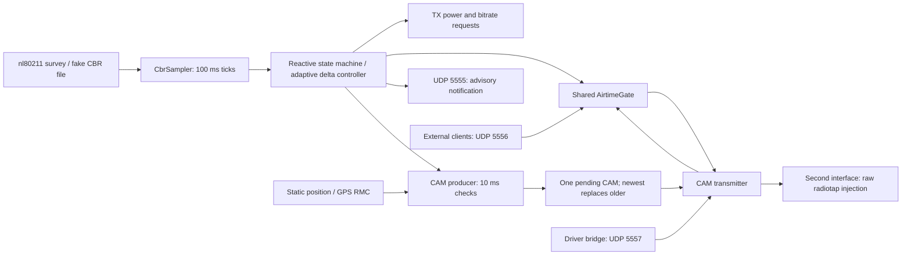

# DCC architecture

This document describes the current implementation. For commands and defaults,
see [README.md](README.md) and [GUIDA_USO.md](GUIDA_USO.md). CAM generation and
the driver bridge are documented in [cam/README.md](cam/README.md).

## Data flow

The gate is an application-level admission service for one channel. Every
producer sharing that channel must cooperate; it cannot intercept unrelated
traffic. The two interface arguments must refer to the intended measured channel
and controlled transmitter.

## Modules

| Source | Responsibility |
| --- | --- |
| `main.cpp` | Validate arguments, select DCC and CAM modes, register SIGINT/SIGTERM, monitor once per second |
| `dcc_manager.cpp/.h` | Own sampler, controller, gate, UDP service and optional CAM sender; append controller telemetry |
| `CBRReader.cpp/.h` | Synchronously query active-channel survey counters through nl80211 |
| `cbr_sampler.cpp/.h` | Acquire independently of control, timestamp/validate observations and publish a bounded queue |
| `dcc_state_machine.cpp/.h` | Five reactive states, adjacent transitions and asymmetric persistence |
| `dcc_adaptive.h` | Filter CBR and update the adaptive delta budget |
| `TxPowerManager.cpp/.h` | Request fixed TX power through `NL80211_CMD_SET_WIPHY` |
| `rate_manager.cpp/.h` | Request legacy bitrate masks through `NL80211_CMD_SET_TX_BITRATE_MASK` |
| `airtime_gate.cpp/.h` | Synchronize admission, reserve one packet and account completion reports |
| `gate_server.cpp/.h` | Serve external gate clients over loopback UDP 5556 |
| `airtime_client.py` | External client requiring a real send-and-wait completion callback |
| `cam/cam_timing.h` | Generation bounds, movement triggers, N_GenCam and optional forced 100 ms policy |
| `cam/cam_generation.h` | Construct CAMs independently of TX; maintain pending slot, source validity, history and expiry |
| `cam/cam_message.cpp/.h` | Parse/check RMC, encode CAM UPER, serialize radiotap/802.11/GN/BTP frames |
| `cam/cam_telemetry.h` | Thread-safe lifecycle counters, TX timing snapshots and append-only CAM CSV with interval TX rate |
| `cam/cam_sender.cpp/.h` | Run producer and transmitter, inject on the second interface and wait for driver feedback |
| `cam/UtilsEncode/` | Bundled generated ASN.1 codec and mandatory CAM construction helper |
| `cam/Asn1_schemas/` | Bundled ASN.1 schema sources |
| `utils.cpp/.h`, `vehicleDataDef.h` | Shared Netlink/time utilities and existing vehicle data definitions |
| `cbr_generator.py` | Write synthetic fractional CBR values atomically and log the trace |
| `tests/` | C++ and Python regression tests; no radio required |

The ASN.1 sources were imported from `ETSI_stack/cam_c++`; a sibling checkout
is no longer needed to build DCC.

## Threads and ownership

`DccManager` owns the CBR sampler, controller worker and UDP gate service. With
CAM enabled, `cam::Sender` also owns a generation worker, which runs a separate
transmitter thread. The main thread reads monitoring values and propagates sender
failures via `check_cam()`.

Only the acquisition thread calls the CBR reader. The sampler's mutex/condition
variable protects its bounded queue. Controller state and advisory interval use
atomics; the gate protects its budget and reservation with a mutex. Generation
and transmission synchronize through `GenerationBuffer`'s mutex. A transmitter
uses an immutable packet snapshot, then clears only the matching pending version;
completion of an older packet cannot erase a newer generated CAM.

The controller attempts `SCHED_FIFO` priority 70. Failure is logged and ordinary
scheduling continues. This scheduling policy does not configure EDCA or guarantee
hardware timing. Sampling, generation and monitoring intervals are nominal.

## CBR and controller timing

`CBRReader` computes `delta_busy / delta_active` on successive survey counters for
the active channel. It establishes a baseline before returning a valid fraction.
Acquisition is synchronous within its own sampler thread; the wrapper does not
launch another thread for each reading.

`CbrSampler` plans UTC-aligned 100 ms reads, stores up to 16 observations and marks
late, missing or invalid windows as unusable. Consumers accept samples no older
than 150 ms. A timeout, invalid sample or sequence gap interrupts continuity.
The reactive worker resets persistence; the adaptive worker resets sample-pair
continuity. The gate is disabled on invalid/stale input. Gate budget validity is
also bounded to 500 ms from the sample timestamp, even if a controller stalls.
The CBR reader uses 80 ms Netlink I/O timeouts; compound operations can take longer.

Reactive initialization selects the state matching the first valid CBR. Later
transitions move one state at a time after 1 second of high CBR or 5 seconds of
low CBR. Configured gate minima are 50/100/200/400/1000 ms and requested bitrates
are 6/12/18/24/24 Mb/s. See the usage guide for thresholds and power levels.

The adaptive controller starts with filtered CBR 0 and delta 0.0006. It updates
on consecutive 100 ms pairs ending at UTC 200 ms boundaries, using alpha 0.016,
beta 0.0012, target 0.68, delta range 0.0006–0.03 and bounded offsets. Power and
bitrate selection are additional project-specific policies.

## Generation and transmission are separate

Normal CAM generation uses live DCC input clamped to 100–1000 ms, motion changes
against the last confirmed TX, a generation timer initially at 1000 ms, and
N_GenCam=3 timed follow-ups after a motion trigger. `--cam-force-100ms` selects a
fixed 100 ms generation policy while keeping radio admission and source validity.
The producer continues checking while the transmitter waits for admission or
completion. Only the newest unsent CAM is retained.

Packets include mandatory containers and scheduled low-frequency data. RMC UTC
provides the reference-position timestamp; the generation wall clock supplies
GeoNetworking time. Missing vehicle sensor data use unavailable values or omitted
optional fields. Path history encodes available fixes and does not implement SAE
J2735 path selection/compression. The current station is an ordinary passenger car.

A construction taking at least 50 ms is discarded without consuming its
trigger. Pending packets expire after at most 1000 ms or at source expiry.
Before injection, the transmitter sets the sequence number and subtracts queue
age from the GN lifetime using 50 ms resolution. Nearly expired packets are not
selected. These checks do not measure kernel/driver queueing time.

## Admission and feedback

`ADMIT` reserves one packet, `GRANT` permits one send, and `REPORT` supplies real
PHY airtime after completion. An admitted reservation stays open until its report;
missing feedback does not automatically reopen the gate. Reports charge at least
the initial reservation. During a reservation, the most restrictive observed
delta is retained. Subsequent budget updates do not erase accumulated debt.

The gate waits at least `max(mode_minimum, charged_airtime / delta)` from report
receipt; this is a conservative project policy. The advisory interval on UDP
5555 is not a packet grant. The internal sender uses the same gate directly,
while external producers use the UDP 5556 service.

The integrated sender notifies a driver bridge with `TX id sequence bytes` and
expects `DONE id actual_airtime_us`. A successful `sendto()` is not completion.
Errors, malformed feedback or a two-second completion timeout stop the CAM worker
and propagate to the main application. No automatic TX retry is attempted after
an uncertain result. Driver feedback is hardware dependent and is not bundled.

## Lifecycle and validation

The manager starts acquisition and control before enabling an optional CAM sender.
Shutdown joins the CAM workers before stopping acquisition, disabling the gate,
joining the controller and stopping the UDP service. A pending completion wait
can take up to two seconds. Telemetry is appended to the working directory and
records requested settings/controller decisions, not proof of hardware success.

`make test` runs reactive, adaptive/gate, CBR acquisition, CAM and Python tests.
The CAM suite includes boundary thresholds, angle wrap, missing data, N_GenCam,
forced mode, low-frequency encoding, pending-slot replacement, expiry and
concurrent generation during a blocked completion callback. Linux radio tests
are still needed to validate actual injection, queue mapping, bitrate and feedback.
