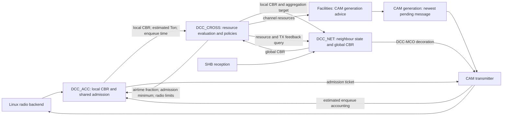

# DCC architecture

[Overview](../README.md) · [Usage](usage.md) · [Standards profile](standards.md) · [DCC_NET](dcc-net.md)

The implementation separates the ETSI DCC entities for one fixed ITS-G5
radio/channel. DCC_CROSS is in the management plane; ACC, NET and the initial
Facilities adapter have distinct responsibilities. These are in-process C++
interfaces, not additional network protocols or processes.

## Components and ownership

| Component | Source | Responsibility |
| --- | --- | --- |
| `DccManager` | `src/dcc/dcc_manager.*` | Compose entities, start/stop workers, route ports, monitor failures and write telemetry |
| `DccAccess` | `src/dcc/dcc_access.*` | Own the sampler and one channel-wide gate; apply radio policy; serialize configuration, decoration and enqueue |
| `DccRadio` / Linux backend | `src/radio/dcc_radio.*` | Isolate survey, TX-power and bitrate operations; preserve synthetic CBR input |
| `DccCross` | `src/dcc/dcc_cross.*` | Select local/global control input; evaluate reactive/adaptive policies; publish Access controls and channel resources |
| `DccNetwork` | `src/net/dcc_network.*` | Own `dccnet::State` and `GnReceiver`; expose explicit local-input/resource ports and SHB decoration |
| `DccFacilities` | `src/dcc/dcc_facilities.h` | Convert channel resource advice into the existing CAM generation lower bound |
| Contracts | `src/dcc/dcc_contracts.h` | Define fractional CBR/budget, temporal validity, estimated TX feedback and resource interfaces |
| CAM sender | `cam/cam_sender.*` | Generate independently, retain the newest pending CAM, request admission and enqueue/account once |

The Facilities component is an adapter for one existing CAM service. It does not
claim a full multi-service DCC_FAC allocator or Release 2 support. DENM/CPM and a
full GeoNetworking router are not added by this change.

`DccManager` no longer owns controller algorithms or Netlink objects. The radio
backend is injectable: the real manager, ACC/CROSS/NET ports and lifecycle can be
tested with simulated hardware on either macOS or Linux.

## Explicit contracts

- **AccessControl:** station airtime fraction, minimum admission interval,
  raw CBR for independent radio limits, requested power upper limit, requested
  legacy bitrate and a monotonic deadline.
- **TxFeedback:** the shared gate's packet identifier, charged estimated airtime,
  and accounting time after successful driver enqueue. This is not an actual PHY
  transmit timestamp or completion report.
- **ChannelResources:** available airtime fraction, admission minimum, estimated
  idle time, suggested admission interval, last TX feedback and validity.
- **NetworkInput:** measured local CBR and the fixed `0.62` GeoNetworking
  aggregation threshold. The adaptive algorithm's distinct target remains `0.68`.

CROSS_Access evaluates policies and resource estimates; ACC enforces admission
and applies radio settings. CROSS_Net exposes the resource query to NET. The SHB
load-exchange implementation has no forwarding scheduler requiring those
resources; the port is available to a future GN integration.

When feedback exists, CROSS calculates estimated idle time as
`ceil(Ton * (1 - CBRa) / CBRa)`. Suggested admission interval is separately
`max(mode_minimum, ceil(Ton / CBRa))`. Before the first TX, the idle time and last
forwarded time remain absent. Reactive generation advice uses the state minimum;
adaptive advice defaults to 1000 ms until there is an airtime estimate.

The CAM adapter clamps generation advice to 100–1000 ms. A capped generation
interval does not cap radio debt. The existing `--cam-force-100ms` remains an
explicit experimental override of generation advice, with radio admission intact.

## Threads, validity and failures

ACC owns the acquisition thread, the manager owns one controller worker, and NET
optionally owns the receive/aggregation worker. CAM has separate generation and
transmitter threads. Existing nominal acquisition and NET cadences remain 100 ms;
adaptive delta updates use consecutive UTC sample pairs ending every 200 ms.

Every accepted control observation refreshes the Access deadline, including odd
adaptive slots that do not update delta. Startup/recovery in adaptive mode needs
a complete valid sample pair. Replays do not extend validity; gaps reset pairing
or reactive persistence. Expired or invalid input disables admission. NET mode
uses global input exclusively and never silently falls back to local control.
Fresh local measurement is required even when remote load is available.

The production gate deadline is the selected sample timestamp plus 150 ms;
NET additionally bounds it by the current local sample's deadline. Applying radio
settings never extends that deadline. Admission and final dispatch recheck
freshness in both local and NET modes. The gate's historical scalar `configure`
overload retains its 500 ms lifetime only for compatibility tests/diagnostics.

Radio configuration/readback, optional DCC-MCO decoration and driver enqueue
share the ACC radio mutex. Cross snapshots and gate accounting have separate
mutexes. No controller or NET-state lock is held during radio I/O. Cached radio
requests avoid repeated Netlink configuration for unchanged values. NET requires
configured-power readback before admission. A failed configuration/readback
closes admission and propagates through `check_cam()` even with CAM disabled.
Bitrate-mask errors propagate just like power errors. Netlink send/receive
waits have checked 80 ms socket timeouts, including family resolution. ACK success
confirms configuration acceptance, not the over-air bitrate; the packet-specific
radiotap RATE remains the basis of the estimate.

Shutdown joins CAM generation/TX, wakes and stops NET/acquisition, joins control,
and leaves admission disabled. Restart resets controller pairing and acquisition;
it does not erase gate debt or an uncertain outstanding send reservation.

## Shared gate and timing policy

All producers on this channel must use the same `DccAccess::admission()` gate.
`reserve()` atomically allocates a channel-wide ticket only when admitted; clients
do not choose their own IDs. `account()` releases that ticket after enqueue and
publishes estimated feedback. The string parser remains for compatibility and
is not an external gate service.

Only one reservation is outstanding. Estimated accounting charges at least the
reservation, retains the tightest delta observed while pending and preserves debt
on policy updates. A failed/uncertain send leaves the reservation closed. Waiting
producers receive no packet ID and cannot release another producer's reservation.

The conservative delay starts after accounting, rather than a measured over-air
transmission. Independently of delta, the gate rejects estimated Ton outside
0 < Ton <= 4 ms and enforces EN 302 571 V2.1.1 §4.2.10.2 Toff, adding Ton before
the idle interval. Raw control/local CBR (the larger in NET mode) drives this guard,
not the adaptive low-pass filter. The tightest CBR, delta and minimum observed
while a reservation is pending survive relaxation before accounting. A rolling
one-second ledger allows at most 30 ms of estimated airtime, counting each whole
packet conservatively until one second after its estimated end. Debt and ledger
survive disable/reconfiguration. Only the regulatory Toff formula is capped at
one second; delta debt is not. This is a project policy, not an
exact reproduction of the informative ETSI Annex B gate. The gate cannot control
traffic injected outside this process; future services must use the shared path.

## Build and validation

Sources remain grouped under `src/`; CAM codec/schemas stay in `cam/`. Make puts
objects, dependencies and tests under `build/` and the application at `./dcc`.
Forwarding headers preserve CAM's historical relative include paths.

`make test` includes eight portable C++ suites, including architecture integration
and the real manager with a simulated radio, plus Python tests. Linux also runs
synthetic Netlink survey parsing and bitrate failure tests. New checks exercise global
input selection, missing/replayed samples, UTC recovery, resource units, multiple
producers sharing one debt, power readback failure, expiry during configuration,
NET resource ports and restart/error propagation without CAM.

Full application compilation and real radio operations require Linux. Existing CI
builds the Linux application before running tests. Injection, configured versus
radiated power, queue mapping, bitrate and actual airtime still require the target
radio/driver. See the [standards profile](standards.md) for requirements and
explicit project choices; software tests do not certify the complete ITS stack.
